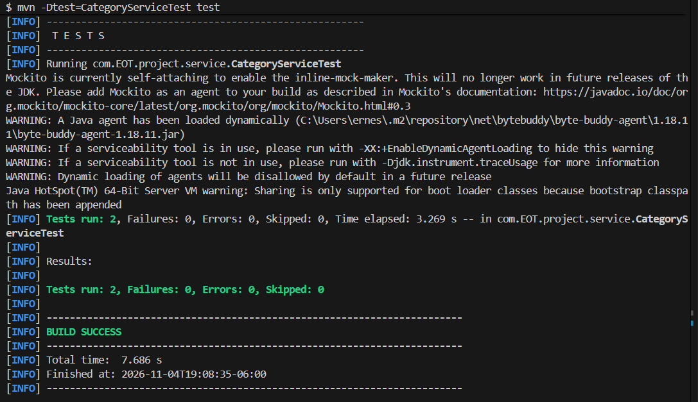

# Pruebas unitarias en Spring Boot: `findAll` y `create`

Práctica de laboratorio de **Aplicaciones Web Progresivas / Desarrollo Backend (IDGS101)**. Se utilizan JUnit, Mockito y AssertJ para comprobar las operaciones `findAll` y `create` del backend de Echoes of the Throne.

## Objetivo

Validar de manera aislada la recuperación y creación de categorías. El repositorio se sustituye por un mock, por lo que estas pruebas no levantan el contexto de Spring ni requieren PostgreSQL, Supabase o H2.

## Tecnologías

- Java 21 y Spring Boot 4.1.1.
- Maven.
- JUnit, Mockito y AssertJ.

## Métodos evaluados

El proyecto ya cuenta con los métodos solicitados en `CategoryService`:

```java
@Transactional(readOnly = true)
public List<CategoryResponseDTO> findAll() {
    return categoryRepository.findByIsDeletedFalse()
            .stream()
            .map(CategoryResponseDTO::fromModel)
            .toList();
}

@Transactional
public CategoryResponseDTO create(CategoryRequestDTO dto) {
    if (categoryRepository.existsByCategoryName(dto.getCategoryName())) {
        throw new ConflictException(
                "La categoría '" + dto.getCategoryName() + "' ya existe"
        );
    }

    CategoryModel category = CategoryModel.builder()
            .categoryName(dto.getCategoryName())
            .description(dto.getDescription())
            .build();

    return CategoryResponseDTO.fromModel(categoryRepository.save(category));
}
```

## Dependencia de pruebas

El archivo `pom.xml` contiene:

```xml
<dependency>
    <groupId>org.springframework.boot</groupId>
    <artifactId>spring-boot-starter-test</artifactId>
    <scope>test</scope>
</dependency>
```

## Pruebas implementadas

La clase se encuentra en `src/test/java/com/EOT/project/service/CategoryServiceTest.java`.

### Prueba de `findAll`

```java
@Test
@DisplayName("Prueba unitaria para listar todas las categorias activas (findAll)")
void testFindAllCategories() {
    CategoryModel secondCategory = CategoryModel.builder()
            .categoryId(UUID.randomUUID())
            .categoryName("Aventura")
            .description("Discusion sobre juegos de aventura")
            .build();
    given(categoryRepository.findByIsDeletedFalse())
            .willReturn(List.of(category, secondCategory));

    List<CategoryResponseDTO> result = categoryService.findAll();

    assertThat(result)
            .isNotNull()
            .hasSize(2)
            .extracting(CategoryResponseDTO::getCategoryName)
            .containsExactly("Estrategia", "Aventura");
    verify(categoryRepository, times(1)).findByIsDeletedFalse();
}
```

### Prueba de `create`

```java
@Test
@DisplayName("Prueba unitaria para crear y guardar una categoria (create)")
void testCreateCategory() {
    CategoryRequestDTO request = new CategoryRequestDTO(
            "Estrategia",
            "Discusion sobre juegos de estrategia"
    );
    given(categoryRepository.existsByCategoryName(request.getCategoryName()))
            .willReturn(false);
    given(categoryRepository.save(any(CategoryModel.class))).willReturn(category);

    CategoryResponseDTO result = categoryService.create(request);

    assertThat(result).isNotNull();
    assertThat(result.getCategoryId()).isEqualTo(category.getCategoryId());
    assertThat(result.getCategoryName()).isEqualTo("Estrategia");
    assertThat(result.getDescription())
            .isEqualTo("Discusion sobre juegos de estrategia");

    ArgumentCaptor<CategoryModel> captor = ArgumentCaptor.forClass(CategoryModel.class);
    verify(categoryRepository, times(1)).save(captor.capture());
    assertThat(captor.getValue().getCategoryName()).isEqualTo("Estrategia");
    assertThat(captor.getValue().getDescription())
            .isEqualTo("Discusion sobre juegos de estrategia");
}
```

La clase utiliza `@ExtendWith(MockitoExtension.class)`, `@Mock` para los repositorios y `@InjectMocks` para construir `CategoryService` sin acceder a una base de datos.

## Ejecución de esta actividad

Para ejecutar **solamente las pruebas de esta práctica**:

```powershell
mvn -Dtest=CategoryServiceTest test
```

Resultado obtenido:

```text
Tests run: 2, Failures: 0, Errors: 0, Skipped: 0
BUILD SUCCESS
```

> El backend contiene más clases de prueba. El comando anterior se limita a `CategoryServiceTest` para obtener evidencia exclusiva de esta actividad. Para ejecutar toda la suite, el comando cambia a `mvn test` y el número total de pruebas será mayor.

## Evidencia visual



## Grupo

IDGS101N

## Integrantes

- Judith Estefanía Hernández Pérez
- Jesús Ernesto Fierro Sandoval
- Emmanuel Ulises Rochin Vargas
- José Iván Solorio Serna
- Jesús Eduardo Aceves Aguirre

